# Product Requirements Document: Mjolnir RTL Security Assurance

<!-- Licensed under the Apache-2.0 license -->
<!-- SPDX-License-Identifier: Apache-2.0 -->

| Field             | Value                                                                                               |
| ----------------- | --------------------------------------------------------------------------------------------------- |
| Status            | Proposed                                                                                            |
| Version           | 1.0                                                                                                 |
| Date              | 2026-08-05                                                                                          |
| Product           | Mjolnir                                                                                             |
| Initiative        | Evidence-driven RTL and hardware security analysis                                                  |
| Baseline          | Upstream `chipsalliance/mjolnir` commit `2a0ba9e`                                                   |
| Intended audience | Maintainers, hardware security engineers, DV/formal engineers, provider authors, and project owners |

## 1. Executive Summary

Mjolnir currently provides an AI-driven, two-phase security review pipeline for Root-of-Trust firmware and RTL source files. Its existing architecture is useful for generating vulnerability hypotheses and filtering obvious false positives, but it is not yet a synthesis-aware or evidence-driven RTL security analysis product.

RTL security properties are rarely local to one source file. They depend on elaborated hierarchy, parameters, package definitions, reset and clock topology, cross-module signal flow, lifecycle policy, instantiated security primitives, assertions, and top-level integration. A convincing finding also requires more than a natural-language argument: it should be supported by source traceability and, where feasible, a formal counterexample, simulation trace, tool diagnostic, or reproducible architectural proof.

This initiative will evolve Mjolnir into an agentic RTL security assurance platform that combines LLM reasoning, DeepWiki MCP repository context, hardware compiler frontends, static analysis, formal verification, simulation, fault injection, and evidence-aware review. The product will preserve Mjolnir's existing project/job model and vulnerability history while introducing design-aware analysis and explicit confidence levels.

The target outcome is not automatic hardware signoff. The target outcome is a high-signal system that finds, validates, prioritizes, and explains security-relevant RTL defects with reproducible evidence and clear assumptions.

## 2. Problem Statement

### 2.1 Current Product Gaps

The upstream baseline exposes `.sv` as an OpenTitan source extension, but the production GenAI auditor has no SystemVerilog mapping and defaults unsupported extensions to a C firmware prompt. More broadly, the current scan pipeline analyzes files independently before adversarial review.

The present architecture has the following limitations:

| Gap                                               | Consequence                                                                                                         |
| ------------------------------------------------- | ------------------------------------------------------------------------------------------------------------------- |
| File-local Phase 1 analysis                       | Cross-module mitigations and vulnerabilities are missed or misinterpreted.                                          |
| No repository-wide semantic context service       | Agents repeatedly reconstruct architecture from isolated files and cannot efficiently verify related-file behavior. |
| No HDL elaboration                                | Parameters, generate blocks, macros, packages, and top-level configurations are not resolved.                       |
| No design hierarchy or signal graph               | The model must infer connectivity from isolated text.                                                               |
| No formal or simulation validation                | Findings remain hypotheses without reachability or temporal evidence.                                               |
| Generic firmware-oriented prompt fallback for RTL | Hardware-specific bug classes receive incomplete guidance.                                                          |
| LLM reviews LLM output                            | Shared misconceptions can survive both audit phases.                                                                |
| Limited evidence schema                           | Reports cannot clearly distinguish suspicion, static evidence, simulation evidence, and formal proof.               |
| No resilient checkpoint/resume                    | Provider failures can waste completed analysis and credits.                                                         |
| No hard cost budget                               | Large or noisy jobs can exceed expected spend.                                                                      |
| Limited deduplication                             | One root cause may appear as many findings, while multi-file root causes may remain fragmented.                     |
| Provider-specific behavior                        | Structured output, tool calling, retries, and compatibility vary across APIs.                                       |
| No hardware-specific benchmark suite              | Quality and regressions cannot be measured objectively.                                                             |

### 2.2 Why Existing LLM-Only Review Is Insufficient

An LLM can identify suspicious patterns such as an ignored validity bit, an unlatched error, an incomplete wipe path, or a secret-dependent branch. It cannot, from one file alone, reliably determine whether:

- The signal is checked by an upstream or downstream module.
- The affected path exists in the elaborated target configuration.
- A parameter disables or replaces the suspicious logic.
- An instantiated hardened primitive provides the missing protection.
- The behavior is reachable under legal protocol and lifecycle states.
- A temporal property can be violated in a real execution trace.
- A simulation-only X condition corresponds to deterministic silicon behavior.
- A masking construction remains secure after synthesis and glitches.

Mjolnir must therefore treat LLM output as a hypothesis until corroborated by design context or technical evidence.

## 3. Product Vision

Mjolnir will become a threat-model-guided hardware security agent that understands the elaborated design, explores security invariants across modules, invokes appropriate verification tools, and produces evidence-backed findings that a hardware security engineer can reproduce and evaluate.

The desired workflow is:

```mermaid
flowchart LR
    A[Project and threat model] --> B[Design ingestion and elaboration]
    B --> C[Security asset and trust-boundary map]
    C --> DW[DeepWiki repository context]
    DW --> D[Agentic hypothesis discovery]
    D --> E[Static and structural checks]
    E --> F[Formal, simulation, or fault validation]
    F --> G[Adversarial evidence review]
    G --> H[Deduplicated findings with confidence and artifacts]
```

## 4. Product Principles

| Principle                      | Requirement                                                                                                       |
| ------------------------------ | ----------------------------------------------------------------------------------------------------------------- |
| Evidence over eloquence        | A polished narrative must never substitute for a reproducible technical basis.                                    |
| Fail explicit, not silent      | Missing elaboration, unavailable tools, and unsupported constructs must be visible in results.                    |
| Design context before severity | Severity may be provisional until reachability and integration assumptions are checked.                           |
| Preserve human authority       | Mjolnir recommends and explains; engineers own acceptance, waiver, and signoff decisions.                         |
| Reproducibility by default     | Every result records revision, configuration, tool versions, prompts, model, and evidence artifacts.              |
| Bounded autonomy               | Agents receive explicit tool, time, token, filesystem, and command limits.                                        |
| Security-specific precision    | The product prioritizes exploitable trust-boundary and invariant violations over generic lint noise.              |
| Incremental adoption           | Projects can use prompt-only triage, design-aware analysis, or full evidence validation based on available tools. |

## 5. Goals

### 5.1 Primary Goals

1. Provide first-class SystemVerilog and Verilog security analysis.
2. Analyze elaborated designs rather than only independent source files.
3. Give agents repository-wide conceptual context through DeepWiki MCP and exact-revision hierarchy, package, signal-flow, reset, clock, and assertion context through local design tools.
4. Validate high-impact hypotheses using static analysis, formal verification, simulation, or fault injection.
5. Represent evidence, assumptions, confidence, reachability, and validation status in the finding model.
6. Reduce false positives through independent evidence checks and cross-module analysis.
7. Make runs resumable, budget-controlled, observable, and reproducible.
8. Establish measurable RTL security benchmarks and release gates.

### 5.2 Secondary Goals

1. Improve firmware-to-hardware boundary analysis for MMIO, key sideload, lifecycle, OTP, flash, entropy, and debug paths.
2. Support incremental scanning of changed RTL and affected hierarchy.
3. Generate candidate assertions and test scenarios from threat-model invariants.
4. Integrate with CI without requiring every project to deploy commercial EDA tools.
5. Preserve provider portability across hosted and self-hosted models.

## 6. Non-Goals

The following are explicitly outside the initial product scope:

- Replacing formal, DV, CDC/RDC, synthesis, physical-design, or security-signoff engineers.
- Claiming proof of absence of RTL vulnerabilities.
- Automatically modifying production RTL without explicit human approval.
- Producing tape-out signoff from LLM judgments alone.
- Automatically exploiting physical devices.
- Full transistor-level, analog, EM, or power side-channel signoff in the first releases.
- Replacing project-specific threat models and security architecture reviews.
- Guaranteeing compatibility with every proprietary simulator or formal engine in the first release.

## 7. Target Users

| Persona                    | Need                                                                                         |
| -------------------------- | -------------------------------------------------------------------------------------------- |
| Hardware security engineer | Find cross-module security invariant violations and assess exploitability.                   |
| RTL designer               | Receive precise, traceable findings with affected signals, states, and remediation guidance. |
| Formal engineer            | Review generated properties, assumptions, and counterexamples.                               |
| DV engineer                | Convert findings into reproducible tests and regressions.                                    |
| Project security lead      | Track coverage, validation status, residual risk, waivers, and trends.                       |
| CI/release engineer        | Run deterministic, bounded scans with machine-readable outcomes.                             |
| Mjolnir provider author    | Implement model backends against a stable capability contract.                               |

## 8. Core User Journeys

### 8.1 Design-Aware RTL Audit

1. A project owner selects a top module, file list or build target, parameter set, defines, and threat model.
2. Mjolnir elaborates the design and records the exact configuration.
3. Mjolnir constructs hierarchy, dependency, register, reset, clock, and signal-flow views.
4. Mjolnir queries DeepWiki MCP for component architecture, related files, intended invariants, and known cross-module relationships.
5. The discovery agent examines security assets and invariants using DeepWiki, local source, and design tools.
6. Candidate findings are linked to modules, signals, source ranges, affected instances, and shared-context provenance.
7. Validation selects an appropriate static, formal, simulation, or fault-injection strategy.
8. The reviewer independently queries DeepWiki and local source to test whether surrounding logic mitigates or invalidates the hypothesis.
9. The dashboard presents confirmed, likely, unvalidated, and rejected findings separately.

### 8.2 Incremental Pull Request Scan

1. Mjolnir receives a baseline revision and candidate revision.
2. It determines changed files and affected elaborated hierarchy.
3. It reuses compatible cached design artifacts and prior validated findings.
4. It analyzes changed logic and relevant dependents within a fixed budget.
5. CI reports new confirmed or likely security regressions and changed assumptions.

### 8.3 Formal Validation of a Hypothesis

1. The agent identifies a temporal claim such as “an invalid key can be accepted.”
2. Mjolnir generates a candidate property, assumptions, bound, and target instance.
3. The formal adapter runs the property in a sandbox.
4. A failure returns a counterexample trace; a pass records scope and proof limits.
5. The evidence reviewer checks vacuity, assumptions, reachability, and interpretation.
6. The final report includes the property and replay command.

### 8.4 Human Triage and Waiver

1. An engineer reviews source context, evidence, assumptions, and tool output.
2. The engineer confirms, rejects, downgrades, requests more validation, or records a waiver.
3. The decision is versioned and survives future incremental scans.
4. A changed relevant assumption invalidates or reopens the prior decision.

## 9. Scope and Priority Definitions

Requirements use the following priorities:

| Priority | Meaning                                                                   |
| -------- | ------------------------------------------------------------------------- |
| P0       | Required for a credible RTL security minimum viable product.              |
| P1       | Required for evidence-backed agentic analysis at practical project scale. |
| P2       | Advanced capability after the core workflow is stable and measured.       |

## 10. Functional Requirements

### 10.1 First-Class HDL Support

| ID      | Priority | Requirement                                                         | Acceptance criteria                                                                                                                        |
| ------- | -------- | ------------------------------------------------------------------- | ------------------------------------------------------------------------------------------------------------------------------------------ |
| HDL-001 | P0       | Support SystemVerilog `.sv` and Verilog `.v` as explicit languages. | Neither extension falls back to a firmware prompt or parser.                                                                               |
| HDL-002 | P0       | Provide hardware-security-specific audit instructions.              | Prompt coverage includes FSM hardening, FI, SCA, reset/CDC, secrets, access control, alerts, entropy, parameters, and synthesis semantics. |
| HDL-003 | P0       | Record unsupported HDL constructs and degraded-analysis mode.       | Every run states whether analysis was source-only, parsed, or elaborated.                                                                  |
| HDL-004 | P1       | Support project-specific language rules and security primitives.    | A project can register known hardened primitives, packages, and false-positive constraints without modifying provider code.                |
| HDL-005 | P1       | Support source mapping through generated and preprocessed RTL.      | Findings map elaborated objects back to original file and line locations.                                                                  |

### 10.2 Design Ingestion and Elaboration

| ID      | Priority | Requirement                                                                                  | Acceptance criteria                                                                                |
| ------- | -------- | -------------------------------------------------------------------------------------------- | -------------------------------------------------------------------------------------------------- |
| ELA-001 | P0       | Accept top modules, source manifests, include paths, defines, parameters, and library paths. | Job configuration can reproduce the intended design variant.                                       |
| ELA-002 | P0       | Integrate at least one open HDL frontend that emits a machine-readable design model.         | A supported OpenTitan or Caliptra target elaborates without manual source concatenation.           |
| ELA-003 | P0       | Persist elaboration diagnostics and partial-success state.                                   | Missing modules, unresolved parameters, and frontend errors are included in metadata and coverage. |
| ELA-004 | P1       | Support multiple named design configurations per repository revision.                        | Findings identify the configuration in which they apply.                                           |
| ELA-005 | P1       | Cache elaboration artifacts by revision and configuration digest.                            | Repeated compatible runs avoid unnecessary elaboration.                                            |
| ELA-006 | P2       | Support netlist-level ingestion for selected validation workflows.                           | A finding can reference synthesized cells and source mapping where available.                      |

### 10.3 Design Knowledge Model

| ID      | Priority | Requirement                                                                                                    | Acceptance criteria                                                                |
| ------- | -------- | -------------------------------------------------------------------------------------------------------------- | ---------------------------------------------------------------------------------- |
| DKM-001 | P0       | Construct module hierarchy and instance relationships.                                                         | Agents can query parents, children, parameters, and source definitions.            |
| DKM-002 | P0       | Construct signal driver and consumer relationships across modules.                                             | Agents can trace a selected signal across ports and assignments.                   |
| DKM-003 | P0       | Index packages, typedefs, enums, parameters, macros, interfaces, and modports.                                 | Queries resolve definitions without ad hoc text search.                            |
| DKM-004 | P1       | Identify reset domains, clock domains, and synchronization elements.                                           | Reports can state domain transitions and reset relationships for relevant signals. |
| DKM-005 | P1       | Index assertions, assumptions, covers, and bind relationships.                                                 | Agents can locate existing properties relevant to a hypothesis.                    |
| DKM-006 | P1       | Identify software-visible registers, fields, access policies, and lock behavior when register metadata exists. | A path can be traced from an MMIO field to affected RTL state.                     |
| DKM-007 | P2       | Build security-taint and information-flow summaries for configured assets and sinks.                           | Secret or integrity-sensitive paths are queryable and exportable.                  |

### 10.4 Security Asset and Invariant Model

| ID      | Priority | Requirement                                                                                              | Acceptance criteria                                                                     |
| ------- | -------- | -------------------------------------------------------------------------------------------------------- | --------------------------------------------------------------------------------------- |
| INV-001 | P0       | Allow project owners to define assets, trust boundaries, attacker capabilities, and security invariants. | Threat-model entities are represented as structured configuration in addition to prose. |
| INV-002 | P0       | Let agents propose structured invariants from prose threat models for human review.                      | Proposed invariants remain unapproved until accepted by a user or project policy.       |
| INV-003 | P1       | Link each finding to one or more violated invariants.                                                    | No validated finding exists without an identified security property or policy.          |
| INV-004 | P1       | Track assumptions separately from facts.                                                                 | Reports list lifecycle, reset, privilege, protocol, and fault assumptions explicitly.   |
| INV-005 | P1       | Detect contradictory assumptions across findings and tools.                                              | Conflicts appear as validation blockers rather than being silently resolved by the LLM. |

### 10.5 Agentic Discovery

| ID      | Priority | Requirement                                                                                                      | Acceptance criteria                                                                               |
| ------- | -------- | ---------------------------------------------------------------------------------------------------------------- | ------------------------------------------------------------------------------------------------- |
| AGT-001 | P0       | Give the initial auditor read-only repository and design-query tools.                                            | Phase 1 can inspect related files, instances, packages, and signal paths before filing a finding. |
| AGT-002 | P0       | Require the auditor to provide a concrete trigger, affected invariant, impact, and context references.           | Findings missing required fields are rejected or marked incomplete.                               |
| AGT-003 | P0       | Preserve all source files and instances consulted for a finding.                                                 | The report includes a context provenance list.                                                    |
| AGT-004 | P1       | Support specialized agents for FSM/FI, information flow, reset/CDC, access control, crypto control, and entropy. | Jobs can select or automatically route hypotheses to domain agents.                               |
| AGT-005 | P1       | Support multi-file and component-level findings.                                                                 | A finding is not forced to identify only one source file.                                         |
| AGT-006 | P1       | Bound agent turns, tool calls, source bytes, elapsed time, and tokens.                                           | Limits are configurable and recorded per finding.                                                 |
| AGT-007 | P2       | Use planner and verifier roles with independently configurable models.                                           | Discovery and validation may use distinct providers without changing finding semantics.           |

### 10.6 Static and Structural Analysis

| ID      | Priority | Requirement                                                                                                                                         | Acceptance criteria                                                    |
| ------- | -------- | --------------------------------------------------------------------------------------------------------------------------------------------------- | ---------------------------------------------------------------------- |
| STA-001 | P0       | Run configurable HDL lint and compile checks before LLM analysis.                                                                                   | Diagnostics are attached to run metadata and available to agents.      |
| STA-002 | P1       | Add security-focused structural checks for ignored qualifiers, unlatched errors, incomplete wipes, unsafe defaults, and one-bit critical decisions. | Checks produce machine-readable evidence with source locations.        |
| STA-003 | P1       | Integrate CDC and RDC results when tools are available.                                                                                             | Domain-crossing findings cite tool evidence and affected paths.        |
| STA-004 | P1       | Detect unused or disconnected security signals with hierarchy awareness.                                                                            | Results distinguish intentional tie-offs and parameter-disabled paths. |
| STA-005 | P1       | Compare implementation against known hardened primitive usage policies.                                                                             | Violations identify required primitive or documented exception.        |
| STA-006 | P2       | Run synthesis-aware structural analysis for selected modules.                                                                                       | Reports identify whether suspicious logic survives synthesis.          |

### 10.7 Formal Property Generation and Validation

| ID      | Priority | Requirement                                                                             | Acceptance criteria                                                                     |
| ------- | -------- | --------------------------------------------------------------------------------------- | --------------------------------------------------------------------------------------- |
| FRM-001 | P1       | Generate candidate assertions from structured hypotheses and invariants.                | Generated properties include target, clock, reset, assumptions, and rationale.          |
| FRM-002 | P1       | Support at least one open formal backend.                                               | A documented reference target can run bounded proof or find a counterexample.           |
| FRM-003 | P1       | Store property source, tool command, logs, status, bound, runtime, and trace artifacts. | Another engineer can replay the result from the run package.                            |
| FRM-004 | P1       | Detect common vacuity and overconstraint conditions.                                    | A passing proof without non-vacuity checks cannot be labeled confirmed-safe.            |
| FRM-005 | P1       | Validate formal evidence with a separate reviewer.                                      | The reviewer assesses assumptions, reachability, trace interpretation, and proof scope. |
| FRM-006 | P2       | Support commercial formal adapters through a stable interface.                          | Proprietary integrations remain optional and do not alter core finding schemas.         |
| FRM-007 | P2       | Generate cover properties for security-critical state and transition reachability.      | Unreachable targets are distinguishable from proven security behavior.                  |

### 10.8 Simulation and Reproduction

| ID      | Priority | Requirement                                                             | Acceptance criteria                                                                |
| ------- | -------- | ----------------------------------------------------------------------- | ---------------------------------------------------------------------------------- |
| SIM-001 | P1       | Generate candidate directed tests or harnesses for testable hypotheses. | Generated artifacts are isolated and never modify target source by default.        |
| SIM-002 | P1       | Support at least one open simulator adapter.                            | A reference test compiles, runs, and records pass/fail plus logs.                  |
| SIM-003 | P1       | Save seeds, commands, waveforms, inputs, and relevant signal traces.    | A failing run can be reproduced from the artifact manifest.                        |
| SIM-004 | P1       | Correlate simulation evidence with source and design objects.           | The final finding identifies the observed violation and cycle.                     |
| SIM-005 | P2       | Reuse existing project DV environments when explicitly configured.      | Mjolnir invokes project-owned tests without silently changing their configuration. |

### 10.9 Fault-Injection Analysis

| ID     | Priority | Requirement                                                                                                                    | Acceptance criteria                                                                      |
| ------ | -------- | ------------------------------------------------------------------------------------------------------------------------------ | ---------------------------------------------------------------------------------------- |
| FI-001 | P1       | Define structured fault models: bit flip, state corruption, signal force, reset glitch, control skip, and bounded multi-fault. | Every FI result names the model, location, cycle window, and duration.                   |
| FI-002 | P1       | Prioritize injection sites from security-critical state and cone-of-influence analysis.                                        | The tool avoids exhaustive blind injection by default.                                   |
| FI-003 | P1       | Detect whether faults violate an invariant, suppress an alert, or prevent cleanup.                                             | Results identify both injected fault and observed security consequence.                  |
| FI-004 | P2       | Measure detection coverage for configured assets and fault models.                                                             | Reports separate detected, tolerated, escaped, unreachable, and inconclusive injections. |
| FI-005 | P2       | Support formal fault analysis where the backend permits it.                                                                    | Formal FI evidence follows the same replay and assumption requirements as other proofs.  |

### 10.10 Side-Channel Analysis

| ID      | Priority | Requirement                                                                                               | Acceptance criteria                                                                |
| ------- | -------- | --------------------------------------------------------------------------------------------------------- | ---------------------------------------------------------------------------------- |
| SCA-001 | P1       | Perform structural checks for secret-dependent control, latency, address, enable, and handshake behavior. | Findings show the secret source and observable sink or timing effect.              |
| SCA-002 | P1       | Track masking shares, recombination points, and randomness consumers for annotated designs.               | The report identifies share-domain violations and missing freshness assumptions.   |
| SCA-003 | P2       | Integrate gate-level or switching-activity workflows when supplied by a project.                          | Evidence records netlist, stimulus, leakage metric, and tool version.              |
| SCA-004 | P2       | Support statistical leakage result ingestion, including TVLA-style outputs.                               | Statistical evidence is reported without claiming universal side-channel security. |

### 10.11 Evidence and Confidence Model

| ID      | Priority | Requirement                                                                              | Acceptance criteria                                                                                |
| ------- | -------- | ---------------------------------------------------------------------------------------- | -------------------------------------------------------------------------------------------------- |
| EVD-001 | P0       | Introduce explicit evidence levels.                                                      | Findings use the evidence taxonomy defined in Section 12.                                          |
| EVD-002 | P0       | Separate severity, confidence, exploitability, validation status, and evidence strength. | These fields cannot be collapsed into one score.                                                   |
| EVD-003 | P0       | Record assumptions, limitations, and unresolved questions.                               | Missing context lowers confidence rather than being omitted.                                       |
| EVD-004 | P1       | Attach immutable evidence artifacts with hashes.                                         | Reports can detect modified logs, traces, or property files.                                       |
| EVD-005 | P1       | Require replay instructions for validated findings.                                      | A validated status is unavailable without a replayable artifact or documented architectural proof. |
| EVD-006 | P1       | Invalidate evidence when relevant revision, configuration, or tool assumptions change.   | Stale evidence is visibly marked and cannot silently retain validated status.                      |

### 10.12 Review, Deduplication, and Lifecycle

| ID      | Priority | Requirement                                                                             | Acceptance criteria                                                                   |
| ------- | -------- | --------------------------------------------------------------------------------------- | ------------------------------------------------------------------------------------- |
| REV-001 | P0       | Include source paths, instances, evidence, and assumptions in adversarial review input. | Review never receives only a summarized finding when richer context exists.           |
| REV-002 | P0       | Distinguish rejected, unvalidated, likely, and validated findings.                      | A model-only finding cannot be labeled validated.                                     |
| REV-003 | P1       | Group findings by root cause and affected invariant.                                    | Duplicate component findings can be merged while preserving affected locations.       |
| REV-004 | P1       | Track human decisions, comments, waivers, and expiration conditions.                    | Decisions are attributed and included in history.                                     |
| REV-005 | P1       | Reopen findings when relevant code, assumptions, configuration, or evidence changes.    | Incremental runs detect invalidated decisions.                                        |
| REV-006 | P2       | Support independent multi-model review for selected high-impact findings.               | Agreement and disagreement are recorded without majority vote being treated as proof. |

### 10.13 Incremental Analysis and Caching

| ID      | Priority | Requirement                                                         | Acceptance criteria                                                            |
| ------- | -------- | ------------------------------------------------------------------- | ------------------------------------------------------------------------------ |
| INC-001 | P1       | Compute changed source and affected hierarchy between revisions.    | Incremental scope includes impacted dependents, not only changed files.        |
| INC-002 | P1       | Reuse compatible parse, elaboration, index, and evidence artifacts. | Cache keys include revision, design config, tool version, and relevant policy. |
| INC-003 | P1       | Compare findings against a baseline run.                            | Reports identify new, changed, resolved, and unchanged findings.               |
| INC-004 | P1       | Support policy-based CI gates on new likely or validated findings.  | Existing accepted risk does not automatically fail unrelated pull requests.    |

### 10.14 Reliability, Checkpointing, and Resume

| ID      | Priority | Requirement                                                                | Acceptance criteria                                                                        |
| ------- | -------- | -------------------------------------------------------------------------- | ------------------------------------------------------------------------------------------ |
| REL-001 | P0       | Persist completed work at phase and finding granularity.                   | A provider or tool failure does not discard successful completed work.                     |
| REL-002 | P0       | Resume an interrupted run without duplicating completed billable requests. | Resumption reports reused and rerun tasks.                                                 |
| REL-003 | P0       | Classify transient, configuration, provider, tool, and analysis failures.  | Failure handling and retry policy depend on class.                                         |
| REL-004 | P1       | Isolate individual file, component, or finding failures.                   | One failure does not terminate an otherwise useful project scan unless policy requires it. |
| REL-005 | P1       | Make all external commands cancellable and time-bounded.                   | Cancellation leaves a consistent checkpoint and terminates child processes.                |

### 10.15 Cost and Resource Governance

| ID      | Priority | Requirement                                                                                | Acceptance criteria                                                                                    |
| ------- | -------- | ------------------------------------------------------------------------------------------ | ------------------------------------------------------------------------------------------------------ |
| CST-001 | P0       | Support hard dollar, input-token, output-token, call, and elapsed-time limits.             | The scheduler stops before exceeding configured hard limits, subject to in-flight request granularity. |
| CST-002 | P0       | Estimate cost before a run and update the forecast during execution.                       | Users see expected low, likely, and high ranges.                                                       |
| CST-003 | P0       | Record usage per phase, file, component, finding, model, and provider.                     | Cost drivers are visible in metadata and dashboard.                                                    |
| CST-004 | P1       | Prioritize work by asset criticality, expected information gain, and validation value.     | Budget exhaustion preserves the highest-priority completed work.                                       |
| CST-005 | P1       | Support provider prompt caching and batch capabilities without changing finding semantics. | Cache/batch usage and savings are reported.                                                            |

### 10.16 Provider Capability Contract

| ID      | Priority | Requirement                                                                                                            | Acceptance criteria                                                            |
| ------- | -------- | ---------------------------------------------------------------------------------------------------------------------- | ------------------------------------------------------------------------------ |
| PRV-001 | P0       | Define provider capabilities for structured output, tools, streaming, token usage, caching, retries, and context size. | Jobs fail configuration validation when required capabilities are unavailable. |
| PRV-002 | P0       | Normalize provider errors and usage data.                                                                              | Core orchestration does not parse provider-specific exceptions.                |
| PRV-003 | P0       | Validate model compatibility with a low-cost preflight request.                                                        | Unsupported model/endpoint combinations fail before source is transmitted.     |
| PRV-004 | P1       | Allow distinct discovery, review, and evidence-review models.                                                          | Model choices are recorded per phase.                                          |
| PRV-005 | P1       | Support zero-retention and self-hosted provider policies.                                                              | Jobs can enforce approved provider classes for sensitive source.               |
| PRV-006 | P1       | Keep authentication and endpoint quirks outside agent logic.                                                           | Agents depend on a stable provider interface.                                  |

### 10.17 Reporting and Dashboard

| ID      | Priority | Requirement                                                                                     | Acceptance criteria                                                                            |
| ------- | -------- | ----------------------------------------------------------------------------------------------- | ---------------------------------------------------------------------------------------------- |
| RPT-001 | P0       | Display evidence level, confidence, validation status, severity, and exploitability separately. | Users cannot mistake an LLM hypothesis for a validated result.                                 |
| RPT-002 | P0       | Show affected design configuration, hierarchy, instances, signals, and source locations.        | Every design-aware finding is navigable to relevant context.                                   |
| RPT-003 | P1       | Present formal traces, simulation waveforms, tool diagnostics, and replay commands.             | Evidence is accessible from the finding page.                                                  |
| RPT-004 | P1       | Show coverage and analysis gaps.                                                                | Unsupported files, failed elaboration, untested invariants, and unavailable tools are visible. |
| RPT-005 | P1       | Export stable JSON and SARIF-compatible results.                                                | CI and external triage tools can consume findings.                                             |
| RPT-006 | P1       | Present cost, token, runtime, and cache metrics.                                                | Project owners can assess analysis efficiency.                                                 |
| RPT-007 | P2       | Visualize hierarchy, signal paths, trust boundaries, and affected cones.                        | Visual views link back to source and evidence.                                                 |

## 11. Required Analysis Domains

The product must support the following RTL security domains. Individual projects may disable irrelevant domains explicitly.

| Domain                  | Representative checks                                                                               |
| ----------------------- | --------------------------------------------------------------------------------------------------- |
| Lifecycle and privilege | Illegal transitions, debug enablement, policy downgrade, fail-open decode                           |
| Key management          | Invalid-key acceptance, share handling, sideload isolation, key wipe, derivation sequencing         |
| Entropy and randomness  | Health failure propagation, reseed behavior, starvation, reuse, predictability                      |
| Cryptographic control   | Mode confusion, operation ordering, key length, nonce uniqueness, error cleanup                     |
| Fault injection         | FSM corruption, instruction/control skip analogues, error suppression, redundant-check independence |
| Side channels           | Secret-dependent timing/control/addressing, share recombination, randomness freshness               |
| Reset and clock         | Partial reset, reset release, retained secrets, clock gating, CDC/RDC                               |
| Access control          | MMIO policy, lock bits, write-once state, debug/JTAG, RACL, DMA                                     |
| Integrity and alerts    | Alert loss, escalation bypass, integrity error recovery, fatal error latching                       |
| Secure boot hardware    | ROM integrity, execute enable, lifecycle-bound boot policy, anti-rollback support                   |
| Memory protection       | Scrambling, ECC/integrity, remanence, access windows, retention state                               |
| Protocol security       | Replay, duplication, backpressure, request/response mismatch, atomicity                             |

## 12. Evidence Taxonomy

Every finding must have exactly one current evidence level. Evidence level does not replace severity or exploitability.

| Level | Name                  | Definition                                                                                                   |
| ----- | --------------------- | ------------------------------------------------------------------------------------------------------------ |
| E0    | Hypothesis            | LLM-generated concern with source references but no independent corroboration.                               |
| E1    | Context-supported     | Cross-module design context supports the claim; reachability or behavior is not independently demonstrated.  |
| E2    | Static-supported      | Parser, compiler, lint, graph, CDC/RDC, synthesis, or structural evidence corroborates the concern.          |
| E3    | Reproduced            | A simulation, test, or deterministic tool workflow demonstrates the violating behavior.                      |
| E4    | Formally demonstrated | A reviewed formal counterexample or proof of violation demonstrates the behavior under explicit assumptions. |
| E5    | Hardware-observed     | The issue is reproduced on FPGA, emulation, or silicon with captured conditions and artifacts.               |

Allowed validation states:

| State        | Meaning                                                                                                                     |
| ------------ | --------------------------------------------------------------------------------------------------------------------------- |
| Candidate    | Newly generated and not independently reviewed.                                                                             |
| Unvalidated  | Review found the claim plausible but evidence is insufficient.                                                              |
| Likely       | Evidence and context strongly support the claim, but reproduction or formal demonstration is incomplete.                    |
| Validated    | Evidence at E3 or higher has passed evidence review, or a narrowly scoped E2 architectural violation is accepted by policy. |
| Rejected     | The claim is incorrect, unreachable, mitigated, or based on invalid assumptions.                                            |
| Inconclusive | Analysis could not resolve conflicting evidence or missing context.                                                         |
| Waived       | A human accepted the risk under explicit scope and expiration conditions.                                                   |

## 13. Data Model Requirements

The existing `Vulnerability` history model should evolve without losing prior run readability. The future schema must represent:

| Entity               | Required fields                                                                                |
| -------------------- | ---------------------------------------------------------------------------------------------- |
| Design configuration | Top, parameters, defines, manifests, include paths, frontend, digest                           |
| Design location      | Module, instance path, signal/state/property, source file, line/column                         |
| Security invariant   | ID, statement, asset, boundary, approved status, assumptions                                   |
| Finding              | Title, description, root cause, impact, severity, exploitability, confidence, validation state |
| Evidence             | Type, level, producer, artifact URI, hash, command, tool version, result, scope                |
| Assumption           | Statement, source, validation status, affected evidence                                        |
| Analysis action      | Agent/model/tool, input provenance, limits, timestamps, result                                 |
| Human decision       | Actor, action, rationale, timestamp, scope, expiration                                         |
| Coverage             | Files, hierarchy, properties, tools, failures, exclusions, degraded modes                      |

Schema migration requirements:

1. Historical firmware findings remain loadable.
2. New optional fields do not change the meaning of existing severity or status values without a documented migration.
3. Schema versions are explicit in serialized output.
4. Artifact references use relative paths or portable URIs suitable for archived run bundles.

## 14. Job Configuration Requirements

The job specification must eventually support the following conceptual fields. Exact syntax is deferred to design.

| Area             | Configuration concepts                                                                |
| ---------------- | ------------------------------------------------------------------------------------- |
| Design           | Top modules, manifests, include paths, defines, parameters, libraries, configurations |
| Analysis domains | Enabled security domains and project-specific policies                                |
| Tools            | Frontend, lint, formal, simulation, CDC/RDC, synthesis, FI adapters                   |
| Validation       | Evidence targets by severity, confidence, and domain                                  |
| Models           | Discovery, adversarial review, evidence review, fallback models                       |
| Limits           | Dollars, tokens, calls, concurrency, time, disk, tool rounds                          |
| Incremental      | Baseline revision/run, cache policy, affected-hierarchy depth                         |
| Privacy          | Allowed providers, retention policy, redaction, artifact encryption                   |
| CI policy        | Failure thresholds, accepted baseline, waiver handling                                |

Configuration validation must occur before cloning-sensitive source is sent to a remote model or expensive tools are started.

## 15. Tool Adapter Contract

All hardware analysis tools must integrate through a stable adapter contract. An adapter must declare:

- Name, version, license class, and availability.
- Supported languages and input artifact types.
- Required configuration and environment.
- Expected outputs and machine-readable parser.
- Timeout, cancellation, and resource behavior.
- Whether the command can modify the workspace.
- Artifact paths and replay command.
- Failure classification and partial-result semantics.

All tool execution must occur in an isolated workspace with explicit allowed paths. Network access is disabled by default for analysis tools unless a job policy enables it.

## 16. Non-Functional Requirements

### 16.1 Reproducibility

| ID          | Requirement                                                                                     |
| ----------- | ----------------------------------------------------------------------------------------------- |
| NFR-REP-001 | Record repository revision, submodule revisions, dirty state, and design configuration digest.  |
| NFR-REP-002 | Record model identifier, provider, prompt version/hash, and generation parameters.              |
| NFR-REP-003 | Record tool versions, commands, environment identity, and relevant seeds.                       |
| NFR-REP-004 | Package enough information to replay every validated finding, subject to licensing constraints. |

### 16.2 Security and Privacy

| ID          | Requirement                                                                             |
| ----------- | --------------------------------------------------------------------------------------- |
| NFR-SEC-001 | Keep credentials out of job specs, logs, dashboards, prompts, and artifacts.            |
| NFR-SEC-002 | Treat source code, traces, netlists, and findings as sensitive data.                    |
| NFR-SEC-003 | Enforce path containment and read-only source access for agents by default.             |
| NFR-SEC-004 | Require explicit approval for commands that can modify source or invoke network access. |
| NFR-SEC-005 | Support provider allowlists and zero-retention policies.                                |
| NFR-SEC-006 | Produce an auditable record of external data transmission.                              |

### 16.3 Performance and Scale

| ID           | Requirement                                                                                                        |
| ------------ | ------------------------------------------------------------------------------------------------------------------ |
| NFR-PERF-001 | Support repositories with at least 10,000 source files without loading all file contents into one model context.   |
| NFR-PERF-002 | Bound concurrency independently for LLM calls, CPU tools, memory-heavy tools, and licensed tools.                  |
| NFR-PERF-003 | Stream progress for long elaboration, proof, simulation, and model operations.                                     |
| NFR-PERF-004 | Permit component-level scans to complete without requiring full-chip elaboration when dependencies are resolvable. |

### 16.4 Portability

| ID           | Requirement                                                                            |
| ------------ | -------------------------------------------------------------------------------------- |
| NFR-PORT-001 | Preserve Nix-based reproducibility for supported open-source tools.                    |
| NFR-PORT-002 | Keep commercial EDA adapters optional and externally configurable.                     |
| NFR-PORT-003 | Support x86_64 Linux first and retain a path to aarch64 Linux where toolchains permit. |

## 17. Evaluation and Benchmark Strategy

Mjolnir must not claim improved RTL security quality based only on anecdotal findings. A benchmark suite is required.

### 17.1 Benchmark Composition

The suite should include:

- Small synthetic RTL examples with one known root cause each.
- Clean negative controls designed to trigger common LLM false positives.
- Mutated OpenTitan- or Caliptra-like components with seeded security defects.
- Publicly disclosed hardware vulnerabilities when licensing and reproduction permit.
- Cross-module cases where the apparent local bug is mitigated elsewhere.
- Parameter-dependent and generate-dependent cases.
- Reset, CDC, lifecycle, access-control, entropy, alert, FI, and information-flow cases.
- Findings requiring temporal reasoning rather than local pattern matching.

### 17.2 Ground Truth

Each benchmark case must define:

- Vulnerable or non-vulnerable label.
- Root cause and violated invariant.
- Required configuration and assumptions.
- Expected source/design locations.
- Minimum acceptable evidence.
- Reproduction or formal property where feasible.

### 17.3 Metrics

| Metric                       | Definition                                                              |
| ---------------------------- | ----------------------------------------------------------------------- |
| Candidate recall             | Fraction of known bugs surfaced at E0 or higher.                        |
| Validated recall             | Fraction of known bugs reaching the required evidence level.            |
| False-positive rate          | Negative controls incorrectly retained as likely or validated.          |
| Root-cause precision         | Findings identifying the actual cause rather than a downstream symptom. |
| Evidence correctness         | Evidence artifacts that genuinely demonstrate the stated property.      |
| Replay success               | Validated findings reproducible in a clean environment.                 |
| Time to first useful finding | Time until the first likely or validated result.                        |
| Cost per useful finding      | Total model/tool cost divided by likely and validated findings.         |
| Incremental efficiency       | Work avoided while preserving benchmark quality on changed revisions.   |

### 17.4 Initial Quality Targets

These are product targets, not guarantees:

| Target                                          | Goal                                                                |
| ----------------------------------------------- | ------------------------------------------------------------------- |
| Clean negative-control precision                | At least 90% not labeled likely or validated                        |
| Replay success for validated open-tool findings | At least 95%                                                        |
| Evidence-field completeness                     | 100% for likely and validated findings                              |
| Resume correctness                              | No duplicate completed model calls in controlled interruption tests |
| Hard-budget compliance                          | No overrun beyond one in-flight request/tool unit                   |
| Cross-module benchmark improvement              | Materially higher validated recall than file-only baseline          |

## 18. Milestones

### Milestone 0: Measurement Baseline

Purpose: establish current quality before changing architecture.

Deliverables:

- RTL benchmark seed suite and negative controls.
- Baseline metrics for current file-by-file GenAI and ADK pipelines.
- Cost and latency measurements.
- Documented current failure modes and provider compatibility matrix.

Exit criteria:

- At least 25 benchmark cases across five RTL security domains.
- Reproducible baseline run artifacts.
- Agreed definitions for candidate, likely, validated, and rejected.

### Milestone 1: RTL-Aware Triage MVP

Purpose: stop treating RTL as firmware and improve hypothesis quality.

Deliverables:

- Explicit `.sv` and `.v` language support.
- Hardware-security audit policy.
- Repository tools available during discovery.
- Multi-file/component finding support.
- Context provenance, assumptions, confidence, and E0/E1 evidence fields.
- Checkpoint/resume and hard budget controls.

Exit criteria:

- No RTL files silently use a firmware prompt.
- Cross-file negative controls show reduced false positives against baseline.
- Interrupted runs resume without duplicate completed calls.
- Reports visibly distinguish hypotheses from validated findings.

### Milestone 2: Elaborated Design Intelligence

Purpose: make analysis hierarchy- and configuration-aware.

Deliverables:

- Open HDL frontend integration.
- Design configuration schema.
- Hierarchy, package, parameter, interface, and signal-query tools.
- Source mapping and degraded-mode reporting.
- Initial asset and invariant model.

Exit criteria:

- One OpenTitan or Caliptra reference component elaborates reproducibly.
- Agent can trace at least one security-relevant signal through hierarchy.
- Parameter-dependent benchmark cases are classified correctly.
- Every finding identifies its applicable design configuration.

### Milestone 3: Evidence-Backed Validation

Purpose: convert selected hypotheses into reproducible technical evidence.

Deliverables:

- Static-analysis adapter framework.
- Open simulator adapter.
- Open formal backend adapter.
- Property/test generation workflow.
- Evidence reviewer and artifact manifest.
- E2-E4 evidence handling and replay commands.

Exit criteria:

- Reference findings can be validated through static, simulation, or formal evidence.
- Formal evidence includes non-vacuity and assumption review.
- At least 95% of validated reference findings replay successfully.
- Model-only findings cannot enter validated state.

### Milestone 4: Fault and Information-Flow Analysis

Purpose: address hardware-specific physical and cross-boundary threats.

Deliverables:

- Structured fault models and injection-site prioritization.
- FI simulation workflow and detection coverage reporting.
- Secret/integrity source-sink annotations and structural flow analysis.
- Masking/randomness structural checks.

Exit criteria:

- Fault escape and detection cases are reproducible on reference designs.
- FI reports distinguish escaped, detected, tolerated, unreachable, and inconclusive outcomes.
- Information-flow findings identify source, sink, path, and violated policy.

### Milestone 5: Incremental CI and Program Management

Purpose: make evidence-driven RTL security analysis operational at project scale.

Deliverables:

- Affected-hierarchy incremental scans.
- Baseline comparison and policy gates.
- Human triage, waiver, expiration, and reopen workflow.
- SARIF and enriched dashboard reporting.
- Project-level coverage, trend, cost, and residual-risk views.

Exit criteria:

- Pull-request scans reuse compatible artifacts and report changed risk.
- Waivers are versioned and automatically invalidated by relevant changes.
- CI gates distinguish new validated risk from accepted baseline findings.

## 19. Release Gates

No milestone may be considered complete unless:

1. Relevant benchmark metrics are reported against the prior baseline.
2. New serialized schemas have compatibility tests.
3. Tool and provider failures have explicit user-visible behavior.
4. Credentials and sensitive content are absent from committed fixtures and logs.
5. Documentation includes a reference job and expected artifacts.
6. Long-running work supports cancellation and consistent checkpointing.
7. Evidence claims are no stronger than the underlying tool result and assumptions.

## 20. Risks and Mitigations

| Risk                                         | Impact                            | Mitigation requirement                                                           |
| -------------------------------------------- | --------------------------------- | -------------------------------------------------------------------------------- |
| LLM fabricates convincing exploit narratives | False confidence                  | Evidence states, independent validation, negative controls, human authority      |
| Generated properties encode the wrong intent | False proof or missed bug         | Invariant linkage, assumption review, vacuity checks, human review               |
| Elaboration differs from production build    | Invalid analysis                  | Configuration digests, build-manifest support, explicit degraded mode            |
| Tool output overwhelms model context         | Missed evidence or excessive cost | Structured summaries, targeted retrieval, artifact references                    |
| Formal state explosion                       | Excessive runtime                 | Cone reduction, bounded checks, prioritization, explicit inconclusive state      |
| Simulation tests do not establish absence    | Overstated assurance              | Evidence taxonomy and restricted validation language                             |
| Provider behavior changes                    | Broken runs or changed results    | Capability preflight, normalized adapter contract, pinned prompt/model metadata  |
| Remote provider leaks sensitive RTL          | Confidentiality loss              | Provider policy, self-hosted options, transmission audit, zero-retention support |
| Generated commands modify source             | Repository corruption             | Sandboxed copies, read-only source mount, explicit approval for writes           |
| Commercial-tool dependence fragments product | Poor portability                  | Open-tool reference path and optional adapter boundary                           |
| Excessive cost from noisy discovery          | Budget failure                    | Hard budgets, prioritization, deduplication, checkpoint/resume                   |
| Benchmarks are overfit                       | Inflated quality claims           | Hidden evaluation set, varied projects, negative controls, periodic refresh      |

## 21. Industry and Research Landscape

This section surveys the current state of LLM-based vulnerability detection and identifies proven architectural patterns Mjolnir should adopt. No approach surveyed here targets synthesizable RTL security; all operate on software source code. Mjolnir must adapt these patterns to hardware while adding RTL-specific capabilities.

### 21.1 Key Systems and Their Approaches

#### RepoAudit (ICML 2025) — Multi-Agent Build-Free Code Auditing

RepoAudit is an autonomous multi-agent framework designed for repository-level code auditing without compilation [[paper](https://arxiv.org/abs/2501.18160), [code](https://github.com/PurCL/RepoAudit)]. It blends traditional static analysis principles with LLM reasoning and currently supports C/C++, Java, Go, Ada, and binary code.

**Architecture worth adopting for Mjolnir:**

| Pattern                                               | How RepoAudit uses it                                                                                           | Mjolnir adoption                                                                                |
| ----------------------------------------------------- | --------------------------------------------------------------------------------------------------------------- | ----------------------------------------------------------------------------------------------- |
| Per-function analysis instead of whole-repo prompting | Decomposes the repository into individual functions, analyzes each with limited scope to prevent hallucinations | Apply to RTL modules, processes, and always blocks instead of whole files                       |
| Build-free call graph construction                    | Constructs inter-procedural context without compilation                                                         | Equivalent needed for RTL: parameter-resolved module instantiation graph without full toolchain |
| Selective context bundling                            | Expands call graph to depth 1 to provide local augmentation while keeping prompts within budget                 | Bundle instantiating modules and instantiated children for each RTL unit                        |
| Path-sensitive reasoning with LLMs                    | Uses LLMs for points-to analysis and path-condition reasoning that traditional static analyzers struggle with   | LLMs reason about security signal propagation, reset sequences, and alert chains                |
| Specialized domain agents                             | Separate agents for NPD, memory leak, data-flow, protocol, property scanning, and binary analysis               | Separate agents for FSM/FI, information flow, crypto control, reset/CDC, access control         |

RepoAudit achieved **185 previously unknown bugs with 85.71% precision**, average **$0.95 per true bug**, and has expanded to **binary firmware scanning** with PoC generation — patterns directly applicable to RTL security at similar scale and cost.

#### IRIS (ICLR 2025) — Neuro-Symbolic LLM + CodeQL Integration

IRIS combines LLMs with the static analyzer CodeQL in a neuro-symbolic pipeline [[paper](https://arxiv.org/abs/2405.17238), [code](https://github.com/iris-sast/iris)]:

1. LLM generates source/sink specifications for a given CWE
2. CodeQL performs whole-repository taint analysis using those specifications
3. LLM filters false positives from CodeQL's results
4. 327+ citations, supports 7+ CWE categories

**Architecture worth adopting for Mjolnir:**

| Pattern                                          | Mjolnir adoption                                                                                    |
| ------------------------------------------------ | --------------------------------------------------------------------------------------------------- |
| LLM identifies security-relevant signals         | Mjolnir auditors name security-critical registers, wires, and state transitions as analysis anchors |
| Traditional tools run analysis from LLM guidance | Use Yosys, Verilator lint, or formal engines from LLM-identified targets                            |
| LLM triages tool results                         | Phase 2 reviews formal counterexamples and lint diagnostics, not only LLM hypotheses                |
| Hybrid precision/recall tradeoff                 | Deterministic tools provide false-positive ceiling; LLMs expand recall                              |

IRIS demonstrates the strongest evidence for the **hybrid LLM + static analysis** architecture, which is the correct north star for Mjolnir's evidence-backed model.

#### DeepSec (Vercel, 2026) — Agent-Powered Large-Scale Vulnerability Scanner

DeepSec is an Apache-2.0 licensed production scanner (6,500+ GitHub stars) [[code](https://github.com/vercel-labs/deepsec)] that runs coding agents against entire repositories with maximum-thinking models. Key architectural decisions:

| Pattern                               | DeepSec's approach                                                                                               | Mjolnir adoption                                                                 |
| ------------------------------------- | ---------------------------------------------------------------------------------------------------------------- | -------------------------------------------------------------------------------- |
| Multi-phase pipeline                  | `scan` (regex matchers, no AI) → `process` (AI investigation) → `revalidate` (reduce false positives) → `export` | Adopt scan → process → revalidate as Mjolnir's Phase 0 → 1 → 2                   |
| Pre-filter with cheap non-AI matchers | Regex patterns identify candidate sites to keep LLM costs bounded                                                | Use lint, structural, and security pattern checks before LLM analysis            |
| INFO.md project context               | Project-specific context injected into every scan batch (primitives, patterns, not exhaustive enumeration)       | Replace full threat-model injection with structured per-project security context |
| Resume by default                     | Interrupted runs pick up where they left off; re-running is safe                                                 | Required: Mjolnir's current no-resume behavior is a critical gap                 |
| Distributed execution                 | Work fans out across sandboxed microVMs                                                                          | Supports the sandboxed tool execution requirement                                |
| `--thinking-level` control            | Tunable model reasoning effort for cost/quality tradeoff                                                         | Support model-specific reasoning controls per phase                              |

#### AgenticSCR, XBOW, VulnHunter, ZeroPath — Agentic and Validation-Focused Systems

| System                                                                            | Key innovation                                                                                      | Mjolnir adoption                                                                                |
| --------------------------------------------------------------------------------- | --------------------------------------------------------------------------------------------------- | ----------------------------------------------------------------------------------------------- |
| **AgenticSCR** [[arxiv](https://arxiv.org/html/2601.19138v1)]                     | Subagents with security-focused semantic memories exploring beyond submitted diffs                  | Phase 1 subagents with persistent security knowledge across files                               |
| **XBOW** [[xbow.com](https://xbow.com/)]                                          | Exploit execution validation eliminates false positives by requiring actual exploitation            | Formal counterexample == XBOW's exploit for RTL; simulation trace == exploit for testable paths |
| **VulnHunter** (Capital One) [[github](https://github.com/capitalone/vulnhunter)] | Open-source agentic AI using attacker-perspective analysis; maps attack paths; proposes remediation | Attacker-perspective agent that assumes physical fault access and probes defenses               |
| **ZeroPath**                                                                      | AI-native SAST finding business logic, auth bypass, vulnerable deps; 125K+ scans/month              | Architecture for finding integration-level security flaws across module boundaries              |
| **llm-sast-scanner** [[github](https://github.com/SunWeb3Sec/llm-sast-scanner)]   | General-purpose SAST for LLM agents: 34 vulnerability classes via source-to-sink taint              | Encode RTL vulnerability classes as structured source-to-sink analysis tasks                    |

### 21.2 Research Findings Directly Relevant to RTL Security

#### 76% of Weakness Categories Require Global Path-Sensitive Reasoning

RepoAudit's empirical finding: 19 out of 25 CWE categories (76%) require **global, path-sensitive reasoning of source-sink reachability** using call graphs and data-flow graphs. Only 6 categories can be effectively identified through localized AST-based analysis [[RepoAudit paper](https://arxiv.org/abs/2501.18160)].

**RTL implication:** Almost all hardware security properties are cross-module. Signal propagation through hierarchy, parameter-dependent behavior, and temporal reachability under specific reset and lifecycle sequences make per-file analysis insufficient by design. This validates Mjolnir's primary architectural requirement for design-aware analysis.

#### The Pairwise Discrimination Problem

LLMs struggle to distinguish vulnerable code from its patched version, suggesting a structural limitation in code-correctness reasoning that is more fundamental than a training data gap [[Augment Code survey](https://www.augmentcode.com/guides/ai-vulnerability-detection)].

**RTL implication:** Mjolnir must not rely on LLMs to judge whether one version of an RTL construct is more secure than another. Evidence must come from tools (lint pass/fail, formal property pass/fail, simulation assertion pass/fail), not from model comparison.

#### Hybrid LLM + SAST Consistently Outperforms Either Alone

Research across multiple venues (ICLR 2025, IEEE S&P 2025, USENIX Security) shows hybrid LLM + deterministic analysis configurations consistently outperform either approach individually: LLMs raise recall, deterministic tools bound false positives [[Augment Code survey](https://www.augmentcode.com/guides/ai-vulnerability-detection)].

**RTL implication:** Mjolnir's correct architecture is LLM → tool → LLM → report, not LLM → report. The tool step (lint, formal, simulation) is the evidence gate that separates hypotheses from validated findings.

#### Anthropic Firefox Red Team: 271 Patches from Agentic Review

Anthropic's agentic red team found 22 security-sensitive vulnerabilities in Firefox using Claude Opus 4.6, with a follow-on using Claude Mythos Preview finding 271 total patches [[Anthropic](https://www.anthropic.com/news/mozilla-firefox-security)]. This validates that agentic code review at repository scale can find real vulnerabilities in well-tested, security-hardened codebases.

**RTL implication:** If agentic review can find vulnerabilities in Firefox — one of the most heavily audited codebases — it can find them in OpenTitan. The question is whether the tooling context (elaboration, hierarchy, property generation) is rich enough.

### 21.3 Adoption Patterns for Mjolnir

Based on the research landscape, Mjolnir should adopt these specific patterns:

1. **Pre-filter before LLM** (DeepSec pattern): Run lint, structural checks, and security pattern matching before sending source to models. Only AI-investigate flagged regions.

2. **Per-unit analysis with selective context** (RepoAudit pattern): Analyze RTL modules one at a time, bundling their instantiating parent and instantiated children for context, rather than whole files or whole repos.

3. **LLM generates tool targets, tools produce evidence** (IRIS pattern): LLM identifies which signals, modules, and properties to check; traditional tools (lint, formal, simulation) produce the evidence; LLM interprets and reports.

4. **Exploit/evidence validation required for confirmed status** (XBOW pattern): No finding reaches Validated without a formal counterexample, simulation trace, or tool diagnostic demonstrating the violating behavior.

5. **Resume-by-default and checkpointing** (DeepSec pattern): Every phase checkpoints completed work; re-running is always safe and never duplicates billable requests.

6. **Project-specific context injection** (DeepSec INFO.md pattern): Structured project knowledge (security primitives, known hardened blocks, false-positive policies) injected into every analysis batch rather than raw threat model prose.

7. **Specialized domain agents** (RepoAudit, AgenticSCR pattern): Separate agents for FSM/FI, information flow, crypto control, reset/CDC, access control, each with domain-specific tools and prompts.

8. **Multi-phase staged pipeline** (DeepSec scan→process→revalidate pattern): Phase 0 (cheap non-AI filtering), Phase 1 (AI discovery with context), Phase 2 (adversarial review with tool evidence), Phase 3 (revalidation against fixes/baseline).

### 21.4 What Research Suggests Mjolnir Should NOT Do

1. **Do not try whole-repository single-prompt analysis.** RepoAudit demonstrated that this produces severe hallucinations. Per-unit decomposition is essential.

2. **Do not treat LLM confidence as security evidence.** All surveyed systems that achieved real-world impact required independent validation — whether static analysis (IRIS), exploit execution (XBOW), or developer confirmation (RepoAudit).

3. **Do not skip the pre-filter.** DeepSec, IRIS, and RepoAudit all pre-filter before LLM analysis. Sending all source to a model is wasteful and produces excessive noise.

4. **Do not evaluate on synthetic benchmarks alone.** The Augment Code survey documents that benchmark results overstate production accuracy, and pairwise discrimination remains unsolved. Real-world validation on OpenTitan/Caliptra is essential.

5. **Do not assume LLM-only composability.** Research consistently shows LLMs struggle with cross-file reasoning without structural aids (call graphs, data-flow graphs). Mjolnir must provide design knowledge graphs regardless of model capabilities.

### 21.5 References

| Reference                                                                                                                                                                             | Venue              | Key contribution                                                                  |
| ------------------------------------------------------------------------------------------------------------------------------------------------------------------------------------- | ------------------ | --------------------------------------------------------------------------------- |
| [RepoAudit: An Autonomous LLM-Agent for Repository-Level Code Auditing](https://arxiv.org/abs/2501.18160)                                                                             | ICML 2025          | 85.71% precision, 185 bugs, $0.95/bug, per-function LLM + call graph architecture |
| [IRIS: LLM-Assisted Static Analysis for Detecting Security Vulnerabilities](https://arxiv.org/abs/2405.17238)                                                                         | ICLR 2025          | Neuro-symbolic LLM + CodeQL, 327 citations                                        |
| [Antaeus: Hunting Repository-Level Logic Vulnerabilities via Context-Grounded LLM Reasoning](https://arxiv.org/html/2607.01138v1)                                                     | 2026               | Call graph depth-1 augmentation for inter-procedural detection                    |
| [AgenticSCR](https://arxiv.org/html/2601.19138v1)                                                                                                                                     | 2026               | Subagents with security semantic memory, autonomous codebase exploration          |
| [VulnHunter](https://github.com/capitalone/vulnhunter)                                                                                                                                | Capital One, 2026  | Open-source agentic AI, attacker-perspective analysis                             |
| [DeepSec](https://github.com/vercel-labs/deepsec)                                                                                                                                     | Vercel, 2026       | Production scanner (6.5K stars), multi-phase, scan→process→revalidate             |
| [XBOW: Agentic AI Merges Static and Dynamic Testing](https://xbow.com/blog/tales-from-the-trace-how-agentic-ai-merges-static-and-dynamic-testing)                                     | 2025               | Exploit execution validation, zero false positives                                |
| [Anthropic Firefox Red Team](https://www.anthropic.com/news/mozilla-firefox-security)                                                                                                 | 2025-2026          | 271 patches, validated agentic review at repository scale                         |
| [What Is AI Vulnerability Detection? The 2026 Guide](https://www.augmentcode.com/guides/ai-vulnerability-detection)                                                                   | Augment Code, 2026 | Survey: hybrid LLM+SAST, pairwise discrimination, false-positive fatigue          |
| [benchmarking LLMs in repo-level vulnerability detection](https://oar.a-star.edu.sg/storage/q/qr3jn0ng6d/acl-2025-benchmarking-llms-agents-in-repo-level-vulnerability-detection.pdf) | ACL 2025           | Repo-level LLM agent benchmarks, inter-procedural detection gap                   |
| [LLMs in Software Security: A Survey](https://dl.acm.org/doi/full/10.1145/3769082)                                                                                                    | ACM, 2025          | 144 citations, comprehensive LLM vulnerability detection survey                   |

## 22. Dependencies

The initiative depends conceptually on:

- A supported HDL parser/elaborator with stable machine-readable output.
- At least one open lint/compiler path.
- At least one open simulation path.
- At least one open formal path.
- Project build metadata sufficient to reproduce relevant configurations.
- A versioned threat model and structured invariant format.
- Provider backends capable of tool use or an orchestration layer that mediates tools independently.
- Storage for logs, traces, waveforms, generated properties, and manifests.

Specific tool selections are architecture decisions and are not mandated by this PRD unless required by an acceptance criterion.

## 23. Open Questions

1. Which HDL frontend should be the primary open reference implementation?
2. Should the design knowledge model use UHDM, another existing IR, or a Mjolnir-owned normalized schema?
3. Which OpenTitan or Caliptra component should become the first elaborated reference target?
4. Which formal backend and property subset provide the most portable MVP?
5. How should project-owned assertions be trusted, versioned, and distinguished from generated assertions?
6. Which evidence levels should be permitted to block CI by default?
7. How should finding identity survive source movement, generated RTL, and hierarchy changes?
8. What privacy policies are required for competition, embargoed, and proprietary targets?
9. Should side-channel structural analysis be part of the core product or an optional domain pack?
10. How should commercial EDA license availability and queue delays affect scheduling and result status?
11. Which benchmark cases can be published without disclosing active vulnerabilities?
12. What level of human approval is required before generated tests or properties execute?

## 24. Product Decisions Required Before Implementation

Implementation must not begin until maintainers approve the following decisions:

1. MVP milestone scope and target reference project.
2. Evidence taxonomy and validation-state semantics.
3. HDL frontend and normalized design-model strategy.
4. Open simulator and formal reference backends.
5. Structured threat-model and invariant schema ownership.
6. Provider capability contract and supported privacy policies.
7. Backward-compatible finding-schema migration strategy.
8. Benchmark ownership, disclosure policy, and quality targets.
9. Default command sandbox and network-access policy.
10. CI blocking policy for likely, validated, and waived findings.

## 25. Definition of Product Success

Mjolnir RTL Security Assurance succeeds when it consistently finds important RTL security defects that file-only LLM review misses, rejects locally suspicious patterns that are mitigated by design context, and validates high-impact findings with evidence that hardware security engineers can independently replay.

Success is not measured by the number of findings. It is measured by root-cause accuracy, validated recall, low false-positive burden, reproducible evidence, bounded cost, and the degree to which engineers can make faster and better-informed security decisions.
